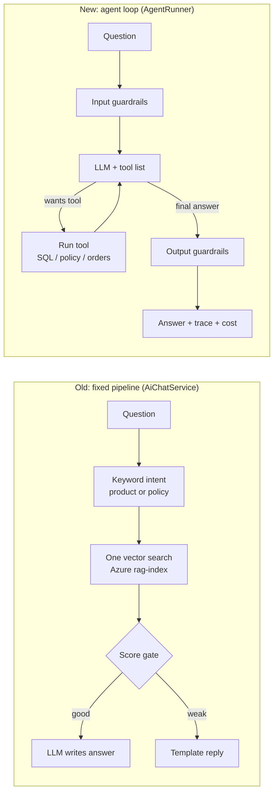
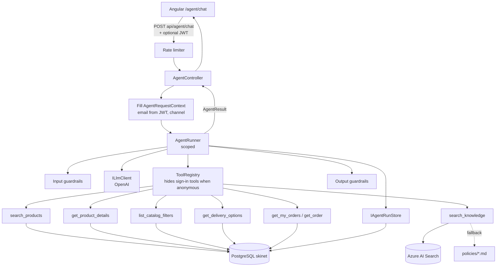
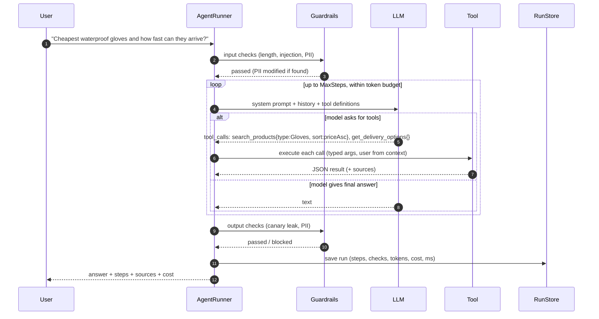
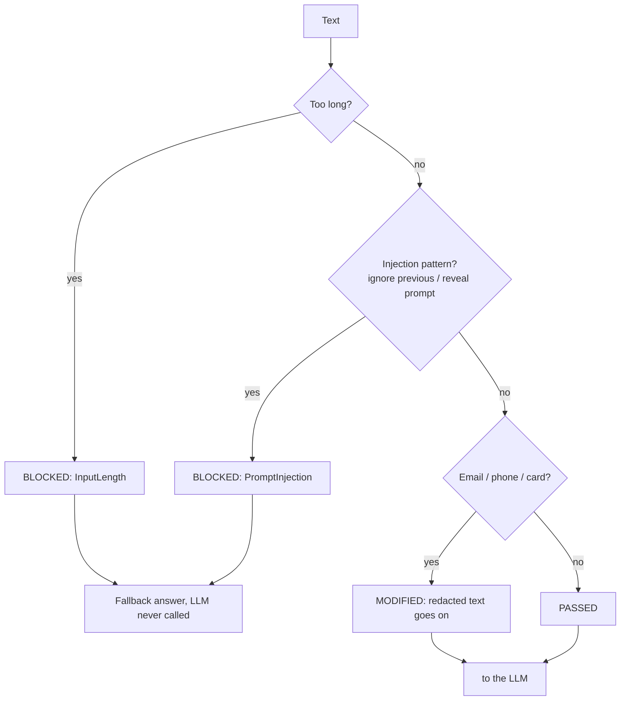
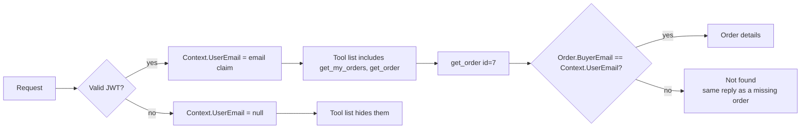
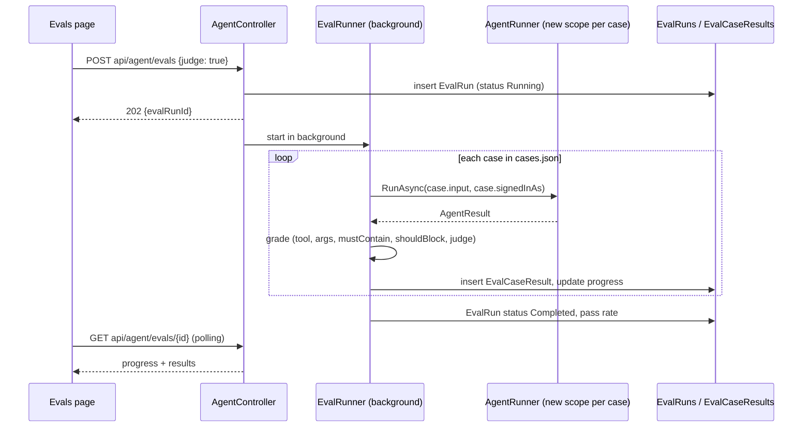
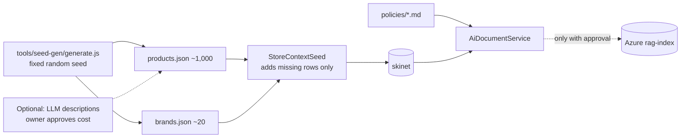

# 03 – Workflow Diagrams

These diagrams use Mermaid. VS Code shows them with a Mermaid preview extension, and GitHub renders them directly. The "How it works" page in Phase 4 reuses them.

## 1. Old flow vs new flow

## 2. Request through the layers

## 3. The agent loop in detail

## 4. Guardrail decisions

Output side: `SecretLeak` blocks when the answer contains the canary, and `PiiRedaction` masks personal data. A guardrail that does not apply (for example the output checks after an input block) is recorded as **Skipped**.

## 5. Sign-in gate for order tools

The model never supplies the email. Even if it puts `email` in the arguments, the tool ignores it.

## 6. Eval run

## 7. Data flow for seeding (Phase 2)

